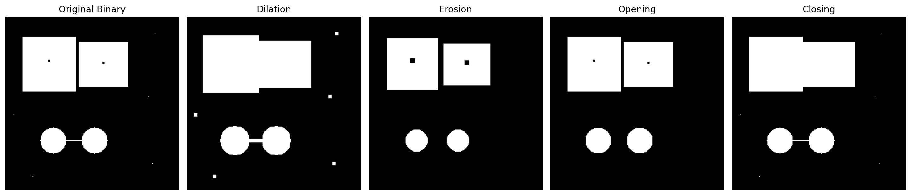

# Morphological Image Processing

## Implemented operations

- **Dilation:** expands foreground (white) regions.
- **Erosion:** shrinks foreground regions.
- **Opening:** erosion followed by dilation, using the same 5×5 square structuring element.
- **Closing:** dilation followed by erosion, using the same structuring element.

## Source and outputs

- [`original_morphology.py`](original_morphology.py): earlier Colab-exported assignment source. It prompts for a user-uploaded image, applies grayscale conversion and Otsu thresholding, then shows the results of all four operations, including intermediate steps.
- [`morphological_operations.ipynb`](morphological_operations.ipynb): a self-contained re-run of the same OpenCV operations on a **generated sample image**; saved outputs render on GitHub without execution.
- [`example_input.png`](example_input.png): generated demonstration input.
- [`results/morphology_comparison.png`](results/morphology_comparison.png): actual output of the demonstration execution.

### Demonstration output

**Note:** The demonstration image is not the original input photo previously uploaded in Colab; it is an explicitly labeled reproducible example. The original source code is provided separately, without claiming the sample output is the original run.
