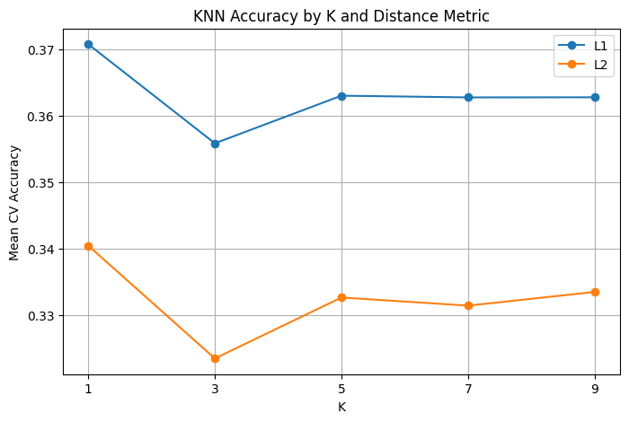
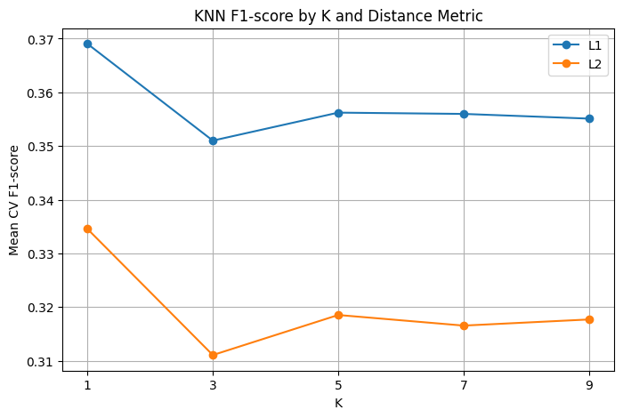
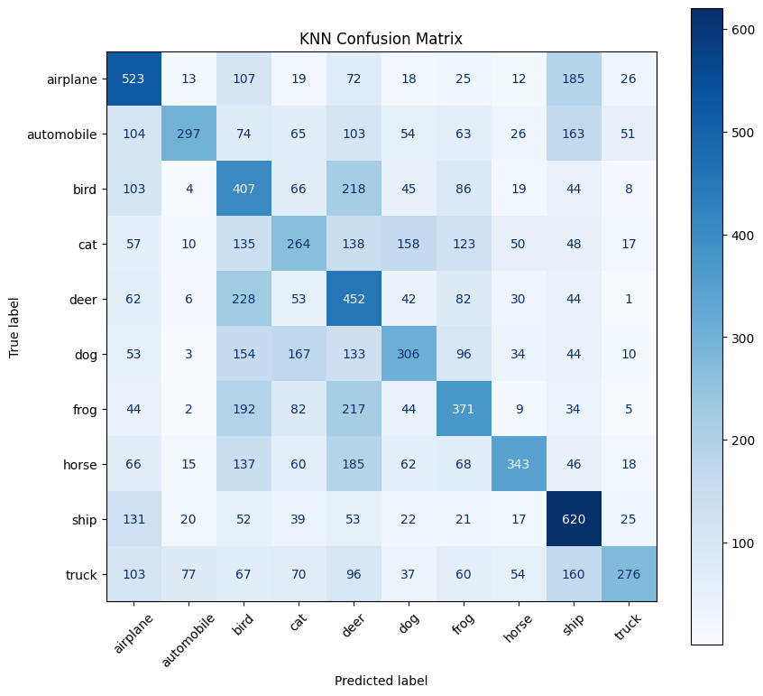

# CIFAR-10 KNN Classification

## Assignment requirements

- KNN classification implementation with neighbor search and majority voting
- K values: **1, 3, 5, 7, 9**
- Distance metrics: **L1 / Manhattan** and **L2 / Euclidean**
- **Stratified 5-fold cross-validation**
- Evaluation: Accuracy, macro Precision, macro Recall, macro F1-score
- Comparison of results by K and metric

## Dataset and procedure

- CIFAR-10: 50,000 train images; 10,000 test images, 10 classes.
- Flatten each 32×32 RGB image to 3072 features, normalize pixel values to [0, 1].
- Distance computation uses `torch.cdist`; nearest-neighbor selection and majority voting are implemented in Python.
- Tune K and the metric by cross-validation on the training set only. Use the held-out test set for final evaluation.
- Dataset is downloaded on demand and not committed to GitHub.

## Original executed notebook

[`CIFAR10_KNN.ipynb`](CIFAR10_KNN.ipynb) — **contains real saved Colab outputs**, not regenerated or fabricated values.

### 5-fold cross-validation (mean accuracy)

| K | L1 | L2 |
|---:|---:|---:|
| 1 | **0.3708** | 0.3405 |
| 3 | 0.3559 | 0.3235 |
| 5 | 0.3630 | 0.3327 |
| 7 | 0.3628 | 0.3315 |
| 9 | 0.3628 | 0.3335 |

**Best configuration by CV accuracy:** L1, K=1 (5-fold mean: 0.3708).

### Final held-out test results

| Metric | Value |
|---|---:|
| Accuracy | **0.3859** |
| Macro Precision | 0.4333 |
| Macro Recall | 0.3859 |
| Macro F1-score | 0.3862 |

Test set size: **10,000 images** (1,000 images for each class).

## Brief comparison

The L1 metric performed better than L2 for every evaluated K value. K=1 achieved the best cross-validation mean accuracy for both metrics, although the highest performance among all tested combinations was L1, K=1. Increasing K did not consistently improve the accuracy in this experiment. The final 38.59% test accuracy illustrates a limitation of pixel-distance-based KNN: images with different objects may have similar low-level colors, backgrounds, or pixel layouts.

The numbers above are from the saved actual Colab outputs. The best setting was selected using cross-validation, with test data kept separate until final evaluation.
