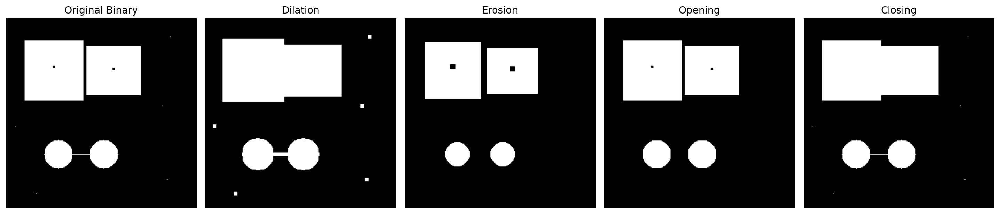
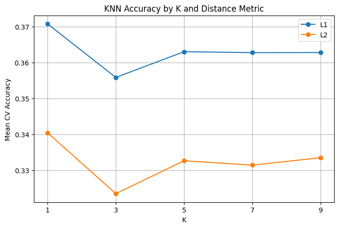

# Image Processing Assignments

Two assignments for the Image Processing course. **Each notebook includes source code and saved execution outputs**, so the results can be viewed directly on GitHub without running Colab.

| Assignment | Contents | Code and results |
|---|---|---|
| [01 — Morphological Operations](01_Morphological_Operations/) | Dilation, Erosion, Opening, Closing | [Executed notebook](01_Morphological_Operations/morphological_operations.ipynb) · [Original assignment code](01_Morphological_Operations/original_morphology.py) |
| [02 — CIFAR-10 KNN](02_CIFAR10_KNN/) | K values, L1/L2, 5-fold CV, metrics | [Original executed Colab notebook](02_CIFAR10_KNN/CIFAR10_KNN.ipynb) |

## Result previews

### Morphological operations

The morphology preview was **re-executed using a generated example image** because the originally manually uploaded image and its saved output were not available. The original Colab-exported source code is preserved in the same folder.

### KNN (CIFAR-10)

For the 5-fold cross-validation, **L1 (Manhattan), K=1** had the highest mean accuracy (**37.08%**). Its final test accuracy was **38.59%** with the full CIFAR-10 training and test sets. Details and additional plots are in the [KNN assignment folder](02_CIFAR10_KNN/).

## Reproducing the experiments

- Open the notebooks in **Google Colab** or Jupyter.
- Morphology: the self-contained demonstration notebook generates its own image; `original_morphology.py` uses Colab's image-upload dialog and requires your own input image.
- KNN: Colab automatically downloads CIFAR-10 to `/content/data`. For the original experiment, GPU acceleration was used if available. Re-running full-data KNN cross-validation can take substantial time.
- The CIFAR-10 dataset itself is **not stored in this repository**.

See [`requirements.txt`](requirements.txt) for the Python libraries.
